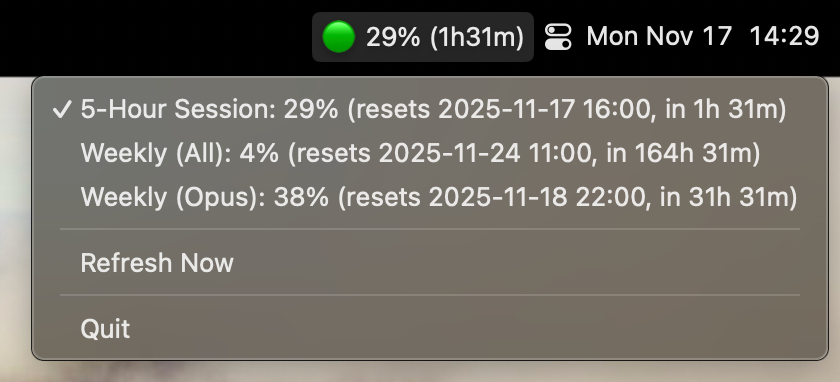

# Claude Monitor Lite

A lightweight menu bar monitor that displays **real-time rate limits** from your Claude Code account.



## Features

- 5-hour session, weekly (all models), and pay-as-you-go extra usage in the menu bar; per-model weekly windows (e.g. Fable) in the terminal status
- Traffic light indicator: 🟢 Green (0-49%), 🟡 Yellow (50-79%), 🔴 Red (80%+)
- Refreshes every 3 minutes, backing off further when the usage endpoint rate-limits; keeps the last numbers while rate-limited, but shows "Error" if fetching keeps failing for any other reason
- Optional live mode: updates within seconds while you use Claude Code, fed by its status line (see [Live updates](#live-updates))
- Watches several Claude Code environments side by side (e.g. personal and work)

**Platform:** macOS. A Linux build is published but untested; `install` is macOS-only.

## Installation

```bash
# Homebrew
brew tap wickes1/tap
brew install --cask claude-monitor-lite

# Go
go install github.com/wickes1/claude-monitor-lite@latest
```

## Usage

Log in to Claude Code once, then run:

```bash
claude-monitor-lite
```

The monitor reuses Claude Code's login — nothing to copy or paste. It reads Claude Code's credential at runtime (Keychain on macOS, `~/.claude/.credentials.json` on Linux), holds it in memory only, and never stores a token of its own.

**Already running:** the command shows the usage the monitor last fetched (it reads the monitor's cache rather than spending another request against the rate limit):

```
$ claude-monitor-lite
✓ Already running (PID: 29525)

As of 13:12:
=== Current Usage ===
5-Hour Session:   21%  (resets 2026-10-17 15:00, in 1h 47m)
Weekly (All):    6%  (resets 2026-10-22 21:00, in 127h 47m)
Extra Usage:    0%
Weekly (Fable):    0%  (resets 2026-10-22 21:00, in 127h 48m)

Menu Bar Shows:  5-Hour Session (🟢 21%)
```

**Switching metrics:** click any metric in the menu to show it in the menu bar. Only windows with data are listed.

## Commands

```bash
claude-monitor-lite              # Start or show status
claude-monitor-lite stop         # Stop the monitor
claude-monitor-lite install      # Start automatically at login
claude-monitor-lite uninstall    # Stop starting at login
claude-monitor-lite statusline install    # Live updates from Claude Code's status line
claude-monitor-lite statusline uninstall  # Restore your original status line
claude-monitor-lite version      # Show version
```

## Which login it reads

The monitor reads whichever Claude Code environment it is started in: `~/.claude` by default, or `CLAUDE_CONFIG_DIR` when that is set. Claude Code isolates everything user-scope under that directory — login/subscription, settings, MCP servers, skills, and history — so launching the monitor from a shell with `CLAUDE_CONFIG_DIR` set monitors that environment instead:

```bash
CLAUDE_CONFIG_DIR=~/.claude-work claude-monitor-lite
```

Each environment runs as its own instance, so two accounts can be watched side by side: start one plainly and one with `CLAUDE_CONFIG_DIR` set. A `CLAUDE_CONFIG_DIR` instance is named after the directory (`~/.claude-work` → `claude-work`), and its menu bar title carries that prefix. Its files are `~/.claude-monitor-lite.<name>-<hash>.{json,pid,log,usage.json,statusline-usage.json,statusline-wrap}`, where `<hash>` is the same directory hash Claude Code uses, so two directories with the same folder name never collide. Run `install` / `stop` / `uninstall` with the same `CLAUDE_CONFIG_DIR` to act on that instance; its LaunchAgent records the variable so autostart watches the same account.

It is read-only toward the credential store: it never writes a Keychain item or credentials file and never refreshes a token — the login is owned by Claude Code. On macOS the credential is the `Claude Code-credentials` Keychain item, or `Claude Code-credentials-<sha256(dir)[:8]>` when `CLAUDE_CONFIG_DIR` is set (Claude Code's own naming); on Linux it is `<dir>/.credentials.json` ([docs](https://code.claude.com/docs/en/authentication)).

## Live updates

The usage endpoint only allows about one request every 2–3 minutes for tools other than Claude Code, so polling cannot go faster. Claude Code, however, already passes the 5-hour and weekly usage to its [status line](https://code.claude.com/docs/en/statusline) command after every response. Opt in to use that:

```bash
claude-monitor-lite statusline install
```

This points `statusLine.command` in `~/.claude/settings.json` (or `$CLAUDE_CONFIG_DIR/settings.json`) at `claude-monitor-lite statusline`, which saves the usage for the monitor and then runs your original status line command unchanged, so your status line looks the same. With no status line configured before, it stays blank. The original `settings.json` is backed up to `settings.json.claude-monitor-lite.bak`.

While Claude Code is in use the menu bar then follows within seconds, at no extra API cost. Polling continues every 3 minutes for everything the status line does not carry: usage from claude.ai or the desktop app, extra usage, and per-model weekly limits. Needs a Claude.ai subscription and a Claude Code version whose status line input includes `rate_limits`; otherwise the monitor simply keeps polling.

`claude-monitor-lite statusline uninstall` restores your original command. Run it before removing the binary (e.g. `brew uninstall`), or Claude Code's status line goes blank. Install again after moving the binary (e.g. switching from a source build to Homebrew) so the status line points at the new path.

## Start at login

Register a LaunchAgent so the monitor starts automatically when you log in:

```bash
claude-monitor-lite install
```

This writes `~/Library/LaunchAgents/io.github.wickes1.claude-monitor-lite.plist` (`….claude-monitor-lite.<name>-<hash>.plist` for a `CLAUDE_CONFIG_DIR` instance) pointing at the binary on your `PATH`, so it keeps working across `brew upgrade`. To disable:

```bash
claude-monitor-lite uninstall
```

`uninstall` disables autostart and stops the running monitor; a reinstall restarts it (run it after `brew upgrade` to switch to the new version). Start it again anytime with `claude-monitor-lite`.

## Troubleshooting

**Menu bar shows "Login":** Claude Code's login is missing or rejected. Log in to Claude Code again; the monitor picks it up on its next refresh.

**App not responding:** Run `killall claude-monitor-lite` then restart.
