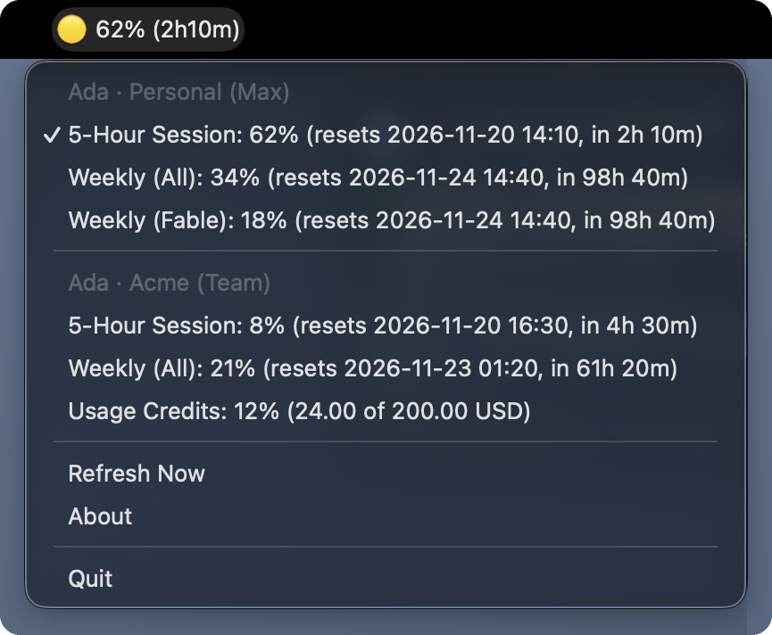

# Claude Monitor Lite

A lightweight menu bar monitor that displays **real-time rate limits** from your Claude Code account.



## Features

- Every usage limit Claude reports for your plan — 5-hour session, weekly (all models), per-model weekly windows (e.g. Fable), usage credits — with any one of them in the menu bar
- Follows your plan: the rows come from Claude's own list of limits, not a built-in one (see [Plans](#plans))
- Traffic light indicator: 🟢 Green (0-49%), 🟡 Yellow (50-79%), 🔴 Red (80%+)
- Refreshes every 3 minutes, backing off further when the usage endpoint rate-limits; keeps the last numbers while rate-limited, but shows "Error" if fetching keeps failing for any other reason
- Optional live mode: updates within seconds while you use Claude Code, fed by its status line (see [Live updates](#live-updates))
- Watches several Claude Code environments in one menu (e.g. personal and work), each as a group named after its account (see [Several accounts](#several-accounts))

**Platform:** macOS. A Linux build is published but untested; `install` is macOS-only.

## Installation

```bash
# Homebrew
brew tap wickes1/tap
brew install --cask claude-monitor-lite

# Go
go install github.com/wickes1/claude-monitor-lite@latest
```

## Usage

Log in to Claude Code once, then run:

```bash
claude-monitor-lite
```

The monitor reuses Claude Code's login — nothing to copy or paste. It reads Claude Code's credential at runtime (Keychain on macOS, `~/.claude/.credentials.json` on Linux), holds it in memory only, and never stores a token of its own.

**Already running:** the command shows the usage the monitor last fetched (it reads the monitor's cache rather than spending another request against the rate limit):

```
$ claude-monitor-lite
✓ Already running (PID: 69953)

As of 09:39:
=== Current Usage ===
5-Hour Session:   12%  (resets 2026-11-17 14:10, in 4h 30m)
Weekly (All):    3%  (resets 2026-11-19 20:00, in 58h 20m)
Weekly (Fable):    3%  (resets 2026-11-19 20:00, in 58h 20m)

Menu Bar Shows:  5-Hour Session (🟢 12%)
```

**Switching metrics:** click a row in the menu to pin it to the menu bar; the checkmark is on the row it shows. Until you pin one, the menu bar shows the limit Claude itself marks as the one to watch, and it falls back to that when a pinned row is no longer part of your plan.

## Plans

The monitor works with any plan that signs in to Claude Code with a Claude subscription. It has no built-in list of a plan's limits: the menu shows whatever the usage endpoint reports for the account, so a limit Anthropic adds or drops needs no update here.

| Plan | Rows to expect |
|---|---|
| Pro, Max, Team | 5-hour session and weekly (all models), plus a per-model weekly row where the plan has one (e.g. Fable) |
| Ultra | Weekly rows; a 5-hour row only until Anthropic has verified the account |
| Enterprise | Seats with usage limits show them like Team. A usage-based seat has no plan limits, and the menu says so |
| Any plan with usage credits turned on | A **Usage Credits** row: percent of the monthly limit and the amount spent |

Checked against the usage responses of Max and Team accounts. The other rows follow Anthropic's published plan descriptions and go through the same code.

Not covered, because there are no plan limits to read: API key and Console logins, Amazon Bedrock, Google Vertex AI, and the Free plan (which does not include Claude Code).

## Commands

```bash
claude-monitor-lite              # Start or show status
claude-monitor-lite stop         # Stop the monitor
claude-monitor-lite add <dir>    # Also watch the Claude Code environment in <dir>
claude-monitor-lite remove <dir> # Stop watching it ("default" names ~/.claude)
claude-monitor-lite install      # Start automatically at login
claude-monitor-lite uninstall    # Stop starting at login
claude-monitor-lite statusline install    # Live updates from Claude Code's status line
claude-monitor-lite statusline uninstall  # Restore your original status line
claude-monitor-lite version      # Show version
```

## Which login it reads

The monitor reads Claude Code's own login: the default environment, `~/.claude`, unless told otherwise. It is read-only toward the credential store: it never writes a Keychain item or credentials file and never refreshes a token — the login is owned by Claude Code. On macOS the credential is the `Claude Code-credentials` Keychain item, or `Claude Code-credentials-<sha256(dir)[:8]>` for a `CLAUDE_CONFIG_DIR` environment (Claude Code's own naming); on Linux it is `<dir>/.credentials.json` ([docs](https://code.claude.com/docs/en/authentication)).

## Several accounts

Claude Code keeps a second account apart by running with `CLAUDE_CONFIG_DIR` set: login, settings, MCP servers, skills and history all live under that directory. Tell the monitor about such an environment once and it watches it alongside the default one:

```bash
claude-monitor-lite add ~/.claude-work
```

The menu then has one group per environment, each with the same rows as before:

```
Ada · Personal (Max)
✓ 5-Hour Session: 12% (resets 2026-11-17 14:10, in 4h 30m)
  Weekly (All): 3% (resets 2026-11-19 20:00, in 58h 20m)
─────────────
Ada · Acme (Team)
  5-Hour Session: 40% (resets 2026-11-17 12:50, in 3h 10m)
  Weekly (All): 21% (resets 2026-11-21 09:00, in 95h 20m)
```

- **Names** come from the account logged in there, as Claude Code records it: your name, the organization for a Team or Enterprise seat or "Personal" for your own plan, and the plan in brackets. An environment whose account cannot be read is named after its folder.
- **The menu bar** still shows one row, without a name: click a row in any group to pin it. Until you do, it shows the first environment's pick.
- **Each group stands alone.** One account failing to load says so in its own group and leaves the menu bar to the selected one.
- **Files:** the list is kept in `~/.claude-monitor-lite.json` (`profiles`, in menu order; an empty string is the default environment). The monitor has one PID file, log and LaunchAgent however many environments it watches; the usage cache and status line feed of an added environment are `~/.claude-monitor-lite.<folder>-<hash>.*`, with the same directory hash Claude Code uses.

`claude-monitor-lite remove ~/.claude-work` stops watching it. Both commands restart a running monitor.

## Live updates

The usage endpoint only allows about one request every 2–3 minutes for tools other than Claude Code, so polling cannot go faster. Claude Code, however, already passes the 5-hour and weekly usage to its [status line](https://code.claude.com/docs/en/statusline) command after every response. Opt in to use that:

```bash
claude-monitor-lite statusline install
```

This points `statusLine.command` in `~/.claude/settings.json` (or `$CLAUDE_CONFIG_DIR/settings.json`) at `claude-monitor-lite statusline`, which saves the usage for the monitor and then runs your original status line command unchanged, so your status line looks the same. With no status line configured before, it stays blank. The original `settings.json` is backed up to `settings.json.claude-monitor-lite.bak`.

While Claude Code is in use the menu bar then follows within seconds, at no extra API cost. Polling continues every 3 minutes for everything the status line does not carry: usage from claude.ai or the desktop app, usage credits, and per-model weekly limits. Needs a Claude.ai subscription and a Claude Code version whose status line input includes `rate_limits`; otherwise the monitor simply keeps polling.

The command acts on the environment it is run in, like Claude Code itself. For an added environment, run it with that directory: `CLAUDE_CONFIG_DIR=~/.claude-work claude-monitor-lite statusline install`.

`claude-monitor-lite statusline uninstall` restores your original command. Run it before removing the binary (e.g. `brew uninstall`), or Claude Code's status line goes blank. Install again after moving the binary (e.g. switching from a source build to Homebrew) so the status line points at the new path.

## Start at login

Register a LaunchAgent so the monitor starts automatically when you log in:

```bash
claude-monitor-lite install
```

This writes `~/Library/LaunchAgents/io.github.wickes1.claude-monitor-lite.plist` pointing at the binary on your `PATH`, so it keeps working across `brew upgrade`. To disable:

```bash
claude-monitor-lite uninstall
```

`uninstall` disables autostart and stops the running monitor; a reinstall restarts it (run it after `brew upgrade` to switch to the new version). Start it again anytime with `claude-monitor-lite`.

## Troubleshooting

**Menu bar shows "Login":** Claude Code's login is missing, rejected, or not a Claude subscription login (an API key or Console login has no plan limits). Log in to Claude Code with your subscription; the monitor picks it up on its next refresh.

**"Waiting for Claude Code":** the access token of that environment has expired. Claude Code renews its token only while it runs, and the monitor never renews it itself, so an environment you have not used for some hours stops updating; the rows are the last reading, with its time. They resume on the next refresh after Claude Code runs there. With the menu bar set to one of those rows, it shows "Error" until then.

**App not responding:** Run `killall claude-monitor-lite` then restart.
